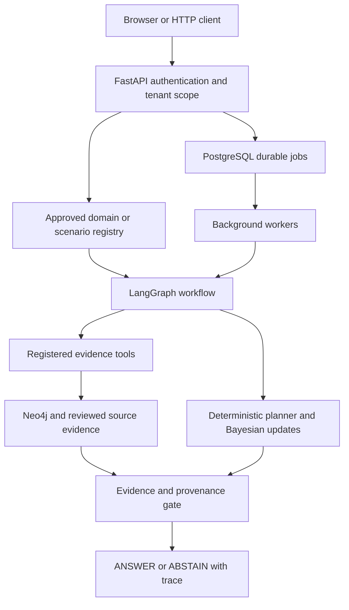

# SentinelPOMDP

Evidence-driven investigation with Bayesian POMDP planning, source provenance,
durable workflows, and justified abstention.

SentinelPOMDP is a research and portfolio system. It chooses registered evidence
actions, updates beliefs when an approved probability model exists, verifies the
supporting sources, and returns `ANSWER` or `ABSTAIN`. Historical delivery lookup
and invoice reconciliation use deterministic factual checks.

## What it demonstrates

- Exact Bayesian updates, information gain, expected utility and finite-horizon
  Bellman planning.
- Neo4j evidence provenance, tenant isolation, source withdrawal and human review.
- LangGraph orchestration and constrained, optional LLM interpretation/explanation.
- FastAPI and an authenticated browser console.
- Versioned domain packs: real historical Olist logistics and synthetic procurement.
- PostgreSQL jobs, leases, fencing, idempotency, cooperative cancellation and checkpoints.

The mathematical engine controls actions and decisions. An LLM cannot grant
permissions, change probabilities, activate a model, or override evidence gates.
The default provider is a deterministic fake; no paid API key is needed.

## Architecture



[Verified architecture and seven diagrams](docs/architecture.md) ·
[Security boundaries](docs/security_and_trust_boundaries.md) ·
[Release validation](docs/release_validation.md)

## Quick start

Tested target: Windows PowerShell, Python 3.13, uv and Docker Desktop.
Dependencies are locked in `uv.lock`. The API is restricted to one process;
background workers use PostgreSQL coordination.

```powershell
git clone https://github.com/AdnanSherwani2003/SentinelPOMDP.git
Set-Location SentinelPOMDP
uv sync --frozen --group dev
uv run --no-sync python scripts/prepare_package_test_cache.py
$env:RUN_LIVE_GROQ_TESTS = '0'
$env:RUN_LIVE_LLM_TESTS = '0'
uv run pytest -q -rs
# Docker Desktop must be running. Creates a separate local demo project.
powershell -NoProfile -File scripts/start_demo.ps1
```

Open `http://127.0.0.1:18082`. The setup creates a private local credential file
under ignored `data/demo/`; use its API key in the console. It initializes
explicitly synthetic evidence and an authorized demo reviewer. No Olist download,
private organizational documents or external inference is needed.

The complete Implementation 20 is published on the default `main` branch.
Dependency installation and the explicit package-cache bootstrap may access the
package registry; subsequent isolated package installation tests run offline.
Local inventories and operational evidence remain private. The
[public validation summary](docs/release_validation.md) distinguishes local checks
from GitHub Actions results and records verification limitations.

For detailed setup, credential handling, shutdown and optional read-only Olist
access, see [quickstart](docs/quickstart.md) and [demo walkthrough](docs/demo_walkthrough.md).

## Supported examples

| Question | Fixture | Expected behavior |
|---|---|---|
| Was Supplier A's shipment late? | Synthetic probabilistic scenario | ANSWER with evidence and posterior |
| Did Supplier A cause the entire production delay? | Synthetic scenario lacking causal support | ABSTAIN |
| Does INV-1001 match PO-2001? | Synthetic procurement | Exact decimal reconciliation |
| Was Olist order `<imported-order-id>` late? | Optional local real archive and reviewed graph | Historical source-row lookup |
| What was its risk at purchase time? | Optional Olist snapshot | INSUFFICIENT_MODEL / ABSTAIN while model is unapproved |

## Evidence and research status

| Capability | Evidence level |
|---|---|
| Bayesian updates and POMDP decisions | Mathematically implemented; deterministic reference tests |
| Investigation policies | Synthetic simulator experiments |
| Provenance and human review | Synthetic integration tests and reviewed Olist records |
| Procurement matching | Synthetic engineering acceptance only |
| Olist delivery lookup | Real historical records; not a forecast |
| Calibration framework | Count-based estimation, smoothing and synthetic holdout tests |
| Olist risk candidates | Historical chronological holdout; unapproved and inactive |
| Real-world autonomous POMDP advantage | NOT EVALUABLE from the Olist archive |
| Production deployment | Not validated or certified |

In the preserved 1,000-episode synthetic benchmark, immediate abstention had
average utility -0.250, compared with -0.300 for horizon-2 POMDP and -0.331 for
one-step expected utility. These results depend on the simulator and reward model.

Olist purchase-time logistic Brier score was 0.033894 versus prior-only 0.033944:
a very small improvement. Carrier-handoff Brier was 0.031949, using a later
information snapshot. Neither establishes autonomous investigation value.
[Evaluation assumptions, uncertainty and limitations](docs/evaluation_summary.md)

## Verification and development

```powershell
uv run python scripts/check_secrets.py
uv run python scripts/audit_release.py
uv run python scripts/demo_api.py
powershell -NoProfile -File scripts/verify_clean_install.ps1
powershell -NoProfile -File scripts/verify_multidomain_live.ps1
```

Paid-provider tests are explicitly opt-in and remain disabled in routine checks.
GitHub Actions runs on pushes and pull requests. Check its actual conclusion;
local validation alone is not a green remote CI result.

[Developer guide](docs/developer_guide.md) · [API reference](docs/api_reference.md) ·
[Domain authoring](docs/adding_a_domain.md) · [Deployment runbook](docs/deployment_runbook.md) ·
[Backup and restore](docs/backup_restore.md) · [Case study and resume bullets](docs/portfolio_case_study.md)

## Scope and license

The validated deployment is a local controlled demonstration with one API process.
Authentication and throttling remain process-local. Community Neo4j backup needs
downtime. Production HA, external alert dispatch, independent security certification
and real company procurement accuracy are unverified.
[Limitations and future work](docs/limitations_and_future_work.md)

Original project material: Copyright 2026 AdnanSherwani2003, licensed under
[Apache-2.0](LICENSE). See [NOTICE](NOTICE). The identifier is the owner's confirmed
GitHub username; this notice does not claim third-party ownership.
Olist data is separately licensed under CC BY-NC-SA 4.0 and is not redistributed
here; the project license does not relicense datasets or dependencies.
[Data sources and attribution](docs/data_sources_and_attribution.md)
Keep raw archives, source documents, credentials, database files and backups out of Git.
