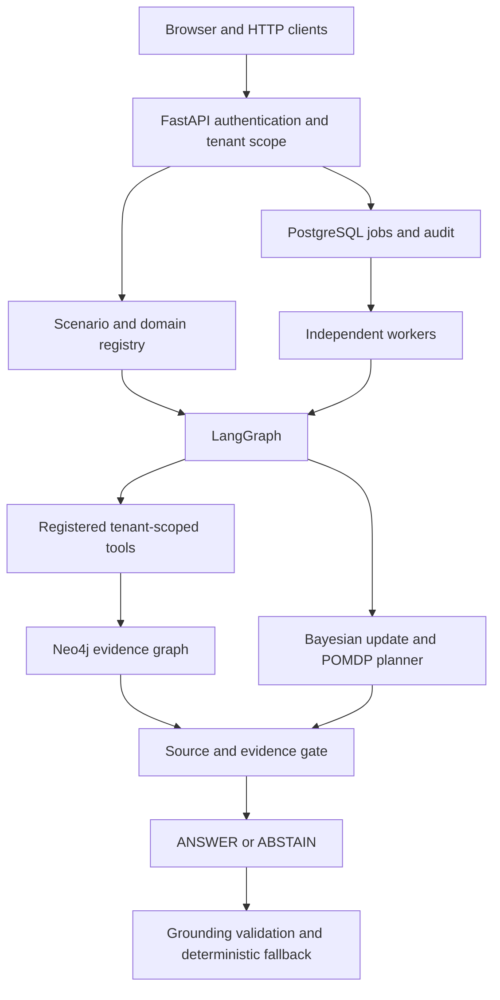
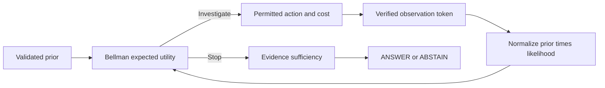
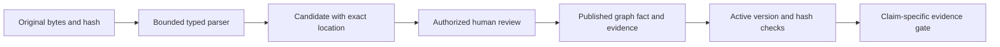
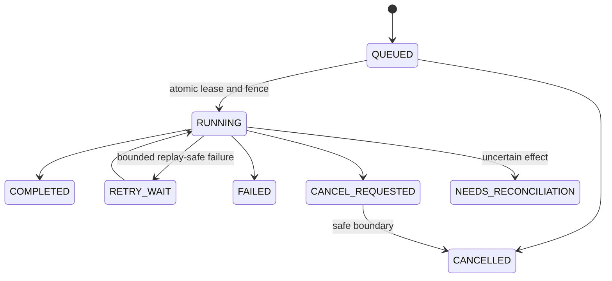
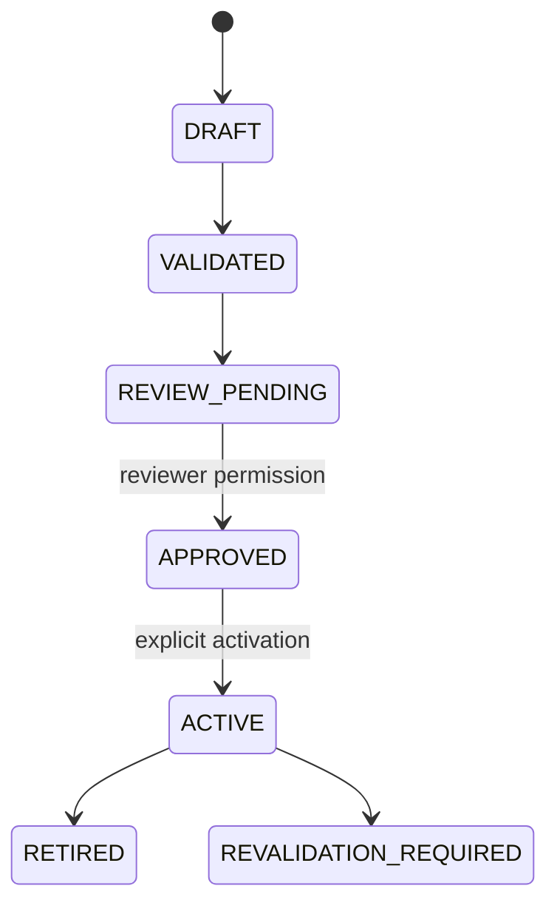
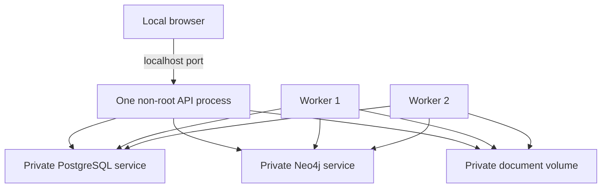
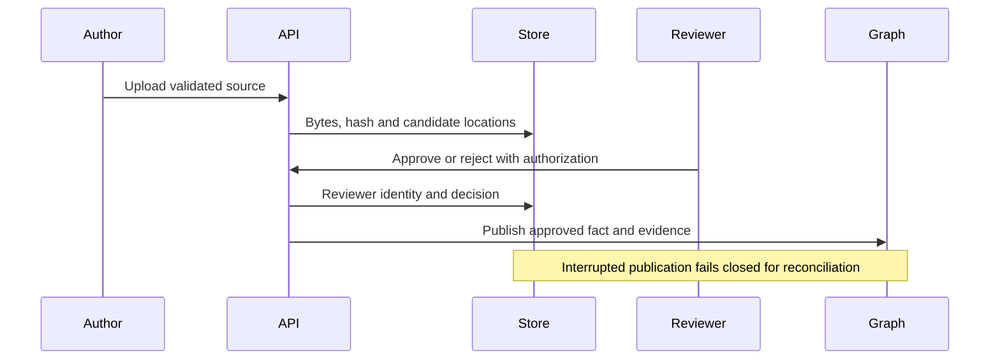

# Verified system architecture

Current scope: Implementations 1–20. Earlier architecture reports describe their
historical milestone; this is the current integration map.

The API authenticates a principal and derives its tenant. A registered scenario or
approved domain defines permitted evidence operations. LangGraph owns workflow
execution; deterministic mathematics owns probability updates and decisions.
Historical facts and document matching take a factual branch with a provenance
gate. PostgreSQL jobs and checkpoints provide durable background execution.

## 1. System

## 2. Investigation loop

The hidden state stays fixed in the bounded investigation model. Distinct modeled
observations assume conditional independence; source groups prevent treating copied
evidence as fresh support. A prediction is not a verified historical outcome.

## 3. Provenance

## 4. Durable jobs

## 5. Domain governance

The service retains legacy PROVISIONAL calibrated candidates and exact-version
rollback. Upload endpoints cannot grant approval or overwrite reviewed metadata.

## 6. Supported deployment

Only the API is published, on loopback. The worker has no HTTP health endpoint;
operations health checks its durable heartbeat. Authentication, throttling and
synchronous traces are process-local. Jobs, operational audit and PostgreSQL
workflow checkpoints persist independently. Filesystem metadata uses atomic writes,
not a distributed document database.

## 7. Human review

No component shown here certifies source truth. A hash verifies byte consistency;
review and provenance establish the recorded support, not universal factual truth.
