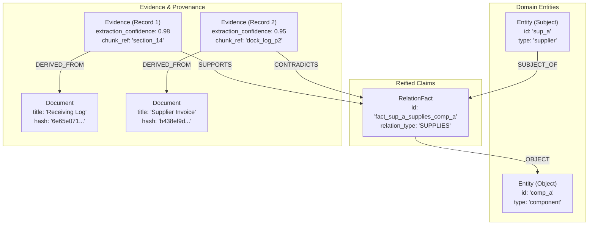

# SentinelPOMDP Knowledge Graph Schema & Metamodel

## 1. Overview and Architectural Purpose

SentinelPOMDP requires a structured, inspectable, and verifiable evidence substrate. While the POMDP reasoning engine maintains mathematical probability distributions over competing hypotheses, the **Knowledge Graph** represents domain entities, observable relations, claims, documents, and evidence items.

In this architecture, **the knowledge graph is not a probabilistic solver**. It is an auditable source of truth and provenance that allows an autonomous agent to:
1. Query what entities and relationships exist in a domain.
2. Traverse multi-hop dependency paths (e.g., Supplier $\to$ Component $\to$ Product).
3. Retrieve specific supporting evidence for any material claim.
4. Detect contradictory evidence across disparate data sources.
5. Trace evidence back to its originating source document, content chunk, and cryptographic hash.
6. Enforce strict tenant isolation boundaries.

---

## 2. Graph Metamodel and Core Nodes



---

## 3. Node Specifications

### 3.1 `Entity`
Represents an identifiable object within a domain (e.g., supplier, component, product, operational incident, or facility).
* **Labels**: `:Entity`
* **Properties**:
  * `entity_id` (`String`, Required): Unique identifier within the tenant scope (e.g., `"sup_a"`).
  * `tenant_id` (`String`, Required): Authorization and isolation boundary (e.g., `"tenant_alpha"`).
  * `entity_type` (`String`, Required): Domain type (e.g., `"supplier"`, `"component"`, `"product"`).
  * `canonical_name` (`String`, Required): Human-readable descriptive name.
  * `attributes_json` (`String`, Optional): JSON serialized arbitrary domain attributes.
  * `created_at` (`String`, ISO 8601): UTC timestamp of record creation.
  * `updated_at` (`String`, ISO 8601): UTC timestamp of latest update.

### 3.2 `Document`
Represents an original source document or record (e.g., PDF receiving log, IoT telematics export, invoice, or Jira ticket).
* **Labels**: `:Document`
* **Properties**:
  * `document_id` (`String`, Required): Unique document identifier (e.g., `"doc_wh_log_001"`).
  * `tenant_id` (`String`, Required): Tenant isolation boundary.
  * `title` (`String`, Required): Descriptive title of the source record.
  * `source_uri` (`String`, Required): Origin URI or filesystem path (e.g., `"synthetic://warehouse/log.pdf"`).
  * `source_type` (`String`, Required): Classification of source (e.g., `"receiving_log"`, `"telematics_audit"`).
  * `classification` (`String`, Required): Security level (`"internal"`, `"confidential"`, `"untrusted_external"`).
  * `raw_content` (`String`, Optional): Raw text content (treated strictly as inert data).
  * `content_hash` (`String`, Required): SHA-256 hex digest of document content.
  * `created_at` (`String`, ISO 8601): Document origin timestamp.
  * `ingested_at` (`String`, ISO 8601): Timestamp of database ingestion.

### 3.3 `Evidence`
Represents a granular, extracted piece of factual evidence referencing a specific chunk of a source document.
* **Labels**: `:Evidence`
* **Properties**:
  * `evidence_id` (`String`, Required): Unique evidence identifier (e.g., `"ev_wh_log_apx101_late"`).
  * `tenant_id` (`String`, Required): Tenant isolation boundary.
  * `document_id` (`String`, Required): Foreign key to the parent `Document`.
  * `chunk_ref` (`String`, Required): Section, line, or table reference in the document.
  * `content` (`String`, Required): Extracted textual or tabular evidence snippet.
  * `extraction_method` (`String`, Required): Parser/extractor type (e.g., `"structured_pdf_parser"`).
  * `extraction_confidence` (`Float`, Required, range $[0.0, 1.0]$): OCR/parser confidence score.
  * `observed_at` (`String`, ISO 8601): Timestamp when the physical event occurred.
  * `created_at` (`String`, ISO 8601): Timestamp when evidence was ingested.

### 3.4 `RelationFact` (Reified Fact)
Represents a specific, identifiable relationship or claim between two entities.
* **Labels**: `:RelationFact`
* **Properties**:
  * `fact_id` (`String`, Required): Unique fact identifier (e.g., `"fact_sup_a_caused_delay"`).
  * `tenant_id` (`String`, Required): Tenant isolation boundary.
  * `relation_type` (`String`, Required): Semantic relation (e.g., `"SUPPLIES"`, `"EXPERIENCED_DELAY"`).
  * `subject_id` (`String`, Required): Foreign key to the subject `Entity`.
  * `object_id` (`String`, Required): Foreign key to the object `Entity`.
  * `attributes_json` (`String`, Optional): Domain attributes (e.g., delay duration, contract status).
  * `observed_at` (`String`, ISO 8601): Timestamp when the fact was observed.
  * `valid_from` / `valid_to` (`String`, Optional): Temporal validity window.
  * `created_at` (`String`, ISO 8601): Timestamp when fact was recorded.

---

## 4. Architectural Trade-off: Reified Facts vs. Direct Relationships

In standard labeled property graphs like Neo4j, relationships are directed edges connecting two nodes:
$$(Entity_1) \xrightarrow{[:RELATION]} (Entity_2)$$

### Why Direct Relationships Are Insufficient for Evidence Provenance
1. **Neo4j Does Not Allow Edges to Point to Edges**: You cannot create an edge from an `:Evidence` node to an existing relationship edge (e.g., `(:Evidence) -> [:SUPPORTS] -> [:SUPPLIES]`).
2. **Multiple Evidence Records**: A single claim (e.g., "Supplier A supplies Component A") may be independently corroborated by an ERP contract, an invoice, and a physical shipping record.
3. **Contradictions Require First-Class Identity**: One document might state a shipment arrived on June 10, while another states June 14. If the relationship is a simple edge, handling contradictory evidence requires overriding properties or creating duplicate competing edges with no audit trail.
4. **Reified Fact Solution**: By making `RelationFact` a node:
   * The fact has a stable, globally addressable ID (`fact_id`).
   * Multiple `:Evidence` items can independently point to it using `:SUPPORTS` or `:CONTRADICTS`.
   * The provenance status (`SUPPORTED`, `CONFLICTED`, `CONTRADICTED`, `UNEVIDENCED`) can be computed deterministically.

---

## 5. Relationships

| Relationship | Start Node | End Node | Cardinality | Semantic Purpose |
| :--- | :--- | :--- | :--- | :--- |
| `SUBJECT_OF` | `:Entity` | `:RelationFact` | $1 \to N$ | Identifies the subject of the claim |
| `OBJECT` | `:RelationFact` | `:Entity` | $N \to 1$ | Identifies the target/object of the claim |
| `SUPPORTS` | `:Evidence` | `:RelationFact` | $N \to M$ | Evidence snippet affirmatively substantiates claim |
| `CONTRADICTS` | `:Evidence` | `:RelationFact` | $N \to M$ | Evidence snippet refutes or contradicts claim |
| `DERIVED_FROM` | `:Evidence` | `:Document` | $N \to 1$ | Traces evidence item to originating source record |

---

## 6. Constraints and Indexes

The following constraints and indexes are established during schema initialization:

```cypher
// Uniqueness constraints scoped by tenant_id
CREATE CONSTRAINT entity_tenant_id_unique IF NOT EXISTS
FOR (e:Entity) REQUIRE (e.tenant_id, e.entity_id) IS UNIQUE;

CREATE CONSTRAINT document_tenant_id_unique IF NOT EXISTS
FOR (d:Document) REQUIRE (d.tenant_id, d.document_id) IS UNIQUE;

CREATE CONSTRAINT evidence_tenant_id_unique IF NOT EXISTS
FOR (ev:Evidence) REQUIRE (ev.tenant_id, ev.evidence_id) IS UNIQUE;

CREATE CONSTRAINT fact_tenant_id_unique IF NOT EXISTS
FOR (f:RelationFact) REQUIRE (f.tenant_id, f.fact_id) IS UNIQUE;

// Performance indexes
CREATE INDEX entity_type_idx IF NOT EXISTS
FOR (e:Entity) ON (e.entity_type);

CREATE INDEX fact_type_idx IF NOT EXISTS
FOR (f:RelationFact) ON (f.relation_type);
```

---

## 7. Canonical Cypher Query Patterns

### 7.1 Provenance Chain Assembly
Retrieves a fact, its subject, object, supporting evidence, contradicting evidence, and source documents:

```cypher
MATCH (ev:Evidence {tenant_id: $tenant_id})-[r]->(f:RelationFact {tenant_id: $tenant_id, fact_id: $fact_id})
MATCH (ev)-[:DERIVED_FROM]->(d:Document {tenant_id: $tenant_id})
WHERE type(r) IN ['SUPPORTS', 'CONTRADICTS']
RETURN type(r) AS rel_type,
       ev.evidence_id AS evidence_id,
       ev.chunk_ref AS chunk_ref,
       ev.content AS content,
       ev.extraction_confidence AS extraction_confidence,
       d.document_id AS document_id,
       d.title AS document_title,
       d.source_uri AS source_uri,
       d.content_hash AS content_hash;
```

### 7.2 Multi-Hop Structural Traversal
Discovers how an entity connects across the supply chain up to $N$ hops:

```cypher
MATCH path = (e1:Entity {tenant_id: $tenant_id, entity_id: $start_id})-[:SUBJECT_OF|OBJECT*1..4]-(e2:Entity {tenant_id: $tenant_id})
WHERE e1 <> e2
RETURN [n in nodes(path) | {
    id: coalesce(n.entity_id, n.fact_id),
    type: coalesce(n.entity_type, n.relation_type),
    name: coalesce(n.canonical_name, n.relation_type)
}] AS traversal_path
LIMIT 50;
```
